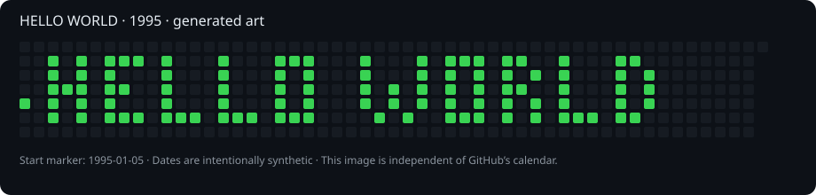

# HELLO WORLD · 1995



**Arte generado con fechas históricas. No representa trabajo realizado en 1995.**

Este proyecto dibuja `HELLO WORLD` en una cuadrícula de calendario con letras compactas de cinco píxeles de altura. Cada píxel activo corresponde a un único commit vacío: **99 fechas**, del **5 de enero al 9 de noviembre de 1995**, a las **12:00 UTC**.

El primer píxel es un marcador del jueves 5 de enero. Las letras empiezan el lunes 16 de enero, después de una semana separadora. Los fines de semana quedan libres en el texto. La imagen SVG es una representación del diseño, no una captura del perfil.

## Estado

- Diseño, SVG, manifiesto y generador preparados y probados.
- Los commits históricos **todavía no están publicados**; publicar los archivos por sí solo no dibuja el calendario.
- La visualización de 1995 en el perfil de GitHub sigue sin verificarse. El SVG garantiza que el diseño se vea en este README.

## Archivos

- `dates.json`: todas las fechas y coordenadas; domingo = 0.
- `generate.py`: generador con la biblioteca estándar de Python, sin dependencias ni llamadas de red.
- `test_generate.py`: validación del diseño, las fechas y la conservación del historial existente.
- `hello-world.svg`: imagen independiente del calendario real de GitHub.

## Reproducir y comprobar

Se requiere Python 3 y Git. Desde un clon de este repositorio:

```sh
python3 -m unittest -v test_generate.py
python3 generate.py --output /tmp/hello-world-preview
```

La carpeta de salida no debe contener los archivos generados: el programa se niega a sobrescribirlos.

## Añadir el historial al clon local

Primero verifica que estás en la rama predeterminada, actualmente `master`, que el árbol de trabajo está limpio y que tu identidad Git usa un correo asociado a tu cuenta GitHub. Puedes usar tu dirección `noreply` verificada en los ajustes de GitHub; no publiques un correo personal innecesariamente.

```sh
git switch master
git pull --ff-only
python3 generate.py --append-history "$PWD"
git log -5 --format='%h %aI %cI %s'
```

El script añade commits vacíos sobre el historial existente, sin modificar archivos, reescribir commits ni subir datos. Rechaza una segunda ejecución si encuentra sus commits. Las fechas de autor y committer son idénticas e intencionalmente históricas, por lo que serán anteriores a las de los commits de preparación que les preceden en el grafo Git.

Después de revisar el resultado, un único push normal publica el historial:

```sh
git push origin master
```

No uses `--force`. Si alguien cambia el remoto antes de publicar, revisa la divergencia antes de continuar.

## Límites del calendario de GitHub

GitHub usa la fecha del autor y exige un correo asociado, un repositorio independiente y commits en la rama predeterminada (o `gh-pages`). El calendario combina otras contribuciones de la cuenta, que podrían alterar el dibujo. Los colores dependen de la actividad del período y no son controlables exactamente. La actualización puede tardar hasta 24 horas. La vista inicial del perfil muestra el último año: este diseño histórico no aparecería allí automáticamente.

No existe una garantía verificada de que la interfaz actual permita ver 1995. El SVG funciona independientemente de eso. No se modifica la fecha real de creación del repositorio ni de la cuenta.

Referencias oficiales: [fechas en Git](https://git-scm.com/docs/git-commit), [criterios de contribuciones](https://docs.github.com/en/account-and-profile/reference/profile-contributions-reference), [visualización histórica](https://docs.github.com/en/account-and-profile/how-tos/contribution-settings/viewing-contributions-on-your-profile), [contribuciones ausentes](https://docs.github.com/en/account-and-profile/how-tos/contribution-settings/troubleshooting-missing-contributions).
